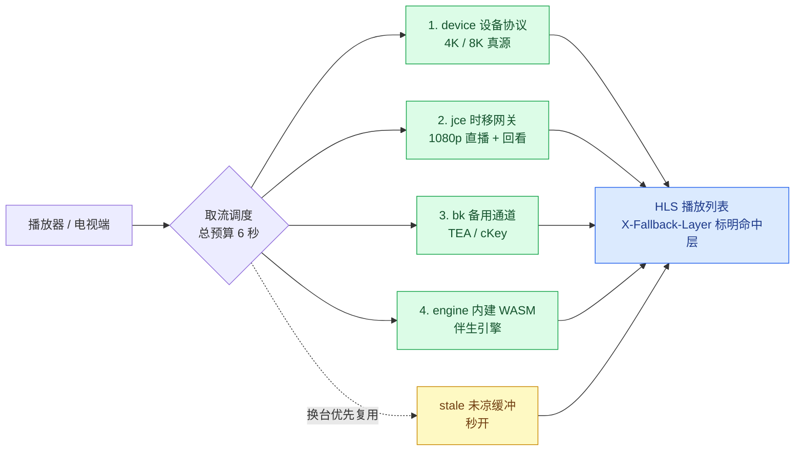

<div align="center">

# ysp-live · 央视频全频道 IPTV 直播网关

**把央视频的 64 路直播，变成任何播放器都能播的 `m3u` / `m3u8` 订阅地址**

单文件二进制 · 单端口对外 · 双引擎四层自动兜底 · 4K/8K 真源 · 支持时移回看

[](#-许可与声明)
[](#-更新记录)
[](#-订阅地址)
[](#-部署)
[](#-交流与获取)

**🐧 交流 / 获取方式：QQ 群 `770840454`** —— 程序包、Docker 镜像、部署答疑都在群里

</div>

---

> **关于本仓库**：这里是**项目主页**，用来介绍功能、写清部署方式与常见问题，**不含源码**。
> Docker 镜像已发布到 Docker Hub，可以直接拉取（见 [部署](#-部署)）；单文件二进制见 [交流与获取](#-交流与获取)。

## 🎬 这是什么

一个**单端口的央视频直播网关**：把央视频（CCTV 央视影音 / Yangshipin）的会员级直播接口，
在服务端解析好、拼装成标准 **HLS 播放列表**，于是你的电视盒子、播放器、NAS、软路由
只要填一个订阅地址，就能直接看央视全频道，**不需要在客户端装任何插件**。

- 🎯 **一次部署，全家可用**：NAS / 软路由 / 小主机 / VPS 上跑一个进程，局域网内所有设备共用。
- 📺 **客户端零要求**：输出标准 `m3u` / `m3u8`，TVBox、影视仓、TiviMate、PotPlayer、VLC、
  Infuse、Kodi 全部直接播，**无需登录、无需会员**。
- 🧩 **不碰客户端改代码**：只要播放器支持 HLS 就能用，断网也能看局域网内的地址。

## ✨ 核心特性

| 能力 | 说明 |
|---|---|
| 📡 **全频道覆盖** | 64 路：央视 + 卫视 + 高清/超高清，`all.m3u` 一条订阅全收 |
| 🎥 **4K / 8K 真源** | 伪装 Android TV 机顶盒走设备协议，取原始高码率流，不是转码 |
| 🔁 **时移回看** | 支持的频道加 `?playseek=` 即可回看指定时段 |
| 🛡 **双引擎四层兜底** | 任一线路故障自动降级，**6 秒总预算**内出画面，绝不 503 断流 |
| ⚡ **换台秒开** | 陈旧缓冲复用 + 分片预取 + 后台升级，实测换台中位 **0.004s** |
| 🔄 **风控自愈** | 遇到上游 400 风控自动换身份重试，带熔断保护，不会越换越糟 |
| 🧱 **单端口单进程** | 网关、1080p 兜底、备用通道、内建 WASM 引擎全部在一个进程里 |
| 🌐 **代理环境友好** | 开着代理也不会把央视切片送出国，国内域名自动直连 |
| 🔐 **密钥自维护** | 定时抓取并校验密钥入库，`/keys` 查看健康度，无需人工干预 |

## 🏗 取流链路

一次播放请求进入网关后，会在 6 秒总预算内**按顺序尝试四层**，谁先成功就用谁，
响应头 `X-Fallback-Layer` 会标明实际命中的是哪一层：



**几个关键设计**：

- **先出画面，再谈画质**。冷启动或换台时不干等 4K，先用 1080p 秒出画面，后台建高码率会话，
  下一次刷新自动无缝升级（插入 `EXT-X-DISCONTINUITY`，播放器不用重开）。
- **陈旧缓冲复用（stale-while-revalidate）**。90 秒内刚看过的频道直接复用缓冲出画、后台换新，
  所以来回切台几乎是瞬时的。
- **同源限流按域名拆开**。某个频道的备用通道连续 403 时，不会把其他频道堵在它后面。
- **失败静默降级**。任一层出错只在日志与 `/diag` 留痕，观众端只会看到画面照常出来。

## 🚀 部署

程序是 `CGO_ENABLED=0` 静态编译的**单文件**，无任何外部依赖，解压即用。
镜像可直接从 Docker Hub 拉取；单文件二进制见 [交流与获取](#-交流与获取)。

### 方式一：Docker（推荐）

镜像已发布在 Docker Hub（`linux/amd64` + `linux/arm64` 双架构，x86 服务器、NAS、软路由都能直接用）：

```bash
docker run -d --name ysp-live \
  -p 8889:8889 \
  -v /path/to/data:/app/data \
  --restart unless-stopped \
  656688515/ysp-live:1.0
```

> **换端口**：监听端口是**第一个位置参数**，追加一个参数覆盖即可 ——
> `docker run -p 9000:9000 ... 656688515/ysp-live:1.0 /app/ysp-live 9000`

### 方式二：单文件二进制

```bash
chmod +x run.sh
./run.sh 8889          # Linux / macOS，自动匹配架构
```

```bat
run.bat 8889           :: Windows
```

| 文件 | 适用平台 |
|---|---|
| `ysp-live-linux-amd64` | x86_64 云服务器 / VPS / 群晖 / 威联通 / Unraid |
| `ysp-live-linux-arm64` | ARM 云服务器、RK3568、晶晨盒子、树莓派 4/5、飞牛 |
| `ysp-live-linux-armv7` | 老款 32 位盒子、树莓派 2/3 |
| `ysp-live-windows-amd64.exe` | Windows x64 |
| `ysp-live-darwin-arm64` | macOS（Apple Silicon） |

不确定选哪个？在设备上执行 `uname -m`：`x86_64` 选 amd64，`aarch64`/`arm64` 选 arm64，
`armv7l` 选 armv7。

### 方式三：宝塔面板

1. **文件** → 新建 `/www/wwwroot/ysp-live` → 上传对应架构的二进制；
2. **终端** → 赋权试跑：

   ```bash
   cd /www/wwwroot/ysp-live
   chmod +x ysp-live-linux-amd64
   mkdir -p data
   YSP_DATA_DIR=/www/wwwroot/ysp-live/data ./ysp-live-linux-amd64 8889
   ```

   看到启动成功的日志即正常，`Ctrl+C` 停掉；
3. **软件商店** → 安装「进程守护管理器」→ 添加守护进程
   （启动命令 `./ysp-live-linux-amd64 8889`，环境变量 `YSP_DATA_DIR=/www/wwwroot/ysp-live/data`）；
4. **安全** → 放行 `8889`（云服务商的安全组也要放行）。

## 📺 订阅地址

下例按 **8889** 端口举例，换成你实际启动的端口即可。

| 用途 | 地址 |
|---|---|
| 全频道订阅（推荐） | `http://<IP>:8889/all.m3u` |
| 仅 4K / 8K 频道 | `http://<IP>:8889/all.m3u?k4=1` |
| 按分组过滤 | `http://<IP>:8889/all.m3u?group=卫视` |
| 单频道播放列表 | `http://<IP>:8889/cctv1.m3u8` |
| 时移回看 | `http://<IP>:8889/cctv1.m3u8?playseek=20260101120000-20260101130000` |
| 健康检查 | `http://<IP>:8889/health` |
| 运行诊断（降级路径 / 统计） | `http://<IP>:8889/diag` |
| 密钥库健康度 | `http://<IP>:8889/keys` |

## ⚙️ 常用配置

大多数情况**开箱即用**，按需微调这几项即可（环境变量写法）：

| 变量 | 默认 | 作用 |
|---|---|---|
| `YSP_DATA_DIR` | 二进制同目录 | 数据持久化目录（密钥库、状态文件都在这） |
| `YSP_FALLBACK_BUDGET` | `6` | 四层兜底链总预算（秒） |
| `YSP_STALE_BUFFER_TTL` | `90` | 缓冲多少秒内可直接复用，调大换台更快 |
| `YSP_KEEPALIVE` | `1` | 上游连接复用；CDN 异常时可设 `0` 退回每分片独立连接 |
| `YSP_PREFETCH` | `2` | 返回播放列表后后台预取的分片数，`0` 关闭 |
| `YSP_WARM_CHANNELS` | `64` | 启动预热的频道数（卫视优先），换台秒开的关键 |
| `YSP_DWELL_SECONDS` | `10` | 停留多久后才后台升级 4K（换台防抖阈值） |
| `YSP_LINKS_PER_DEVICE` | `6` | 单设备高码率并发配额上限 |
| `YSP_ROTATE_DAILY_LIMIT` | `5` | 风控自愈每日换身份次数上限 |
| `YSP_PROXY_MODE` | `auto` | 代理分流：`auto` / `env` / `off` / `force` |
| `YSP_KEY_HARVEST_INTERVAL` | `6h` | 密钥抓取周期；`YSP_KEY_HARVEST=0` 可关闭 |

常用命令行参数：`--no-4k`（只走 1080p）、`--only-4k`（只让 4K 频道走设备协议）、
`--bind <addr>`、`--data-dir <dir>`、`--cache-mb <n>`。

## 🩺 运行状态

| 想知道什么 | 怎么看 |
|---|---|
| 现在健康吗 | `GET /health`，里面带各层可用性 |
| 刚才为什么降级了 | `GET /diag`，打印完整降级路径与耗时 |
| 密钥还有效吗 | `GET /keys`，只显示脱敏摘要（前 6 位 + 后 4 位 + 长度） |

**实测数据**（同一台机器、25 个频道连续换台）：中位 **0.004s**、p95 **0.019s**、
最慢 **0.030s**，无一超过 1 秒；冷启动首次出画面亦在秒级。

## ❓ 常见问题

<details>
<summary><b>某个频道突然看不了了，是我的问题吗？</b></summary>

先访问 `/diag` 看那一层是不是在报错。上游央视侧会不定期调整接口、加强风控，
本项目的四层兜底就是为这种情况准备的——通常会自动切到备用线路继续播。
如果全层失败，`/diag` 里会留下完整原因，方便定位。
</details>

<details>
<summary><b>换台很慢 / 开始几秒卡顿怎么办？</b></summary>

- 确认 `YSP_KEEPALIVE=1`（默认开），连接复用是分片流畅的前提；
- 把 `YSP_STALE_BUFFER_TTL` 调大（如 `180`）可以让来回换台更快；
- 机器性能太差或内存很小的话，把 `--cache-mb` 调小、`YSP_PREFETCH=0` 关掉预取；
- 如果是 4K 频道卡，先用 `--no-4k` 验证 1080p 是否稳定，以排除网络上行瓶颈。
</details>

<details>
<summary><b>开着代理能用吗？</b></summary>

能。默认 `YSP_PROXY_MODE=auto` 会**自动分流**：国内 CDN、央视域名、内网地址一律直连，
只有真正需要代理的流量才走代理。也可以设 `off`（全直连）或 `env`（完全交给系统代理）。
</details>

<details>
<summary><b>为什么我的订阅地址不能公开分享？</b></summary>

订阅地址等于你的服务器入口。公开后别人会消耗你的带宽，也可能因为并发过高
触发上游风控。建议只在家庭/小范围内使用。
</details>

<details>
<summary><b>支持多少路同时观看？</b></summary>

单设备高码率默认并发上限 6 路（`YSP_LINKS_PER_DEVICE`），空闲 30 秒自动释放配额。
1080p 通道的并发上限更高，家庭场景（同时 3~5 台设备）绰绰有余。
</details>

## 💬 交流与获取

<div align="center">

### 🐧 QQ 群：`770840454`

**程序包（含各平台二进制）、Docker 镜像、部署答疑、版本更新 —— 都在群里**

</div>

加群请说明来意（例如「央视直播网关」），便于管理员通过。

## 🗒 更新记录

**v1.0**（当前版本）

- 单端口单进程架构：网关 / 1080p 兜底 / 备用通道 / 内建 WASM 引擎合一；
- 双引擎四层自动兜底（device → jce → bk → engine），6 秒总预算，失败仍返回上一次可用列表；
- 风控自愈：上游 400 自动换身份重试，带最小间隔与每日上限熔断；
- 换台防抖 + 陈旧缓冲复用，来回切台接近瞬时；
- 单设备并发配额池、代理环境自动分流、密钥定时抓取入库；
- 5 平台静态二进制 + Docker 镜像（对外 8889）。

## ⚠️ 免责声明

> 本项目**仅供个人学习、技术研究与家庭自用**，请勿用于任何商业用途，请勿公开传播订阅地址。
>
> * 所有直播流内容（画面、音轨、节目单）的著作权均归**中央电视台及各原始权利人**所有，
>   本项目**不存储、不录制、不转播**任何内容，仅做接口解析与协议转换，播放行为发生在使用者本机；
> * 使用者需自行确保其使用行为符合当地法律法规及服务条款；因使用本项目产生的任何后果，
>   由使用者自行承担；
> * 本项目与央视、央视频及其关联公司**无任何隶属、合作或授权关系**；
> * 如有侵权或不当之处，请通过 QQ 群联系，我们会立即处理。

## 📄 许可与声明

> **版权所有 (c) 2026 繁华**
>
> 本程序以 **Apache License 2.0** 授权发布，许可证全文见本仓库 [`LICENSE`](LICENSE)。
> 你可以自由使用与再分发本程序的二进制（含商业用途），只需保留版权声明与许可证副本。
>
> **关于源码**：本仓库为项目主页，**不含源码**。程序以编译产物形式提供。
>
> **关于专利**：本程序所实现的部分技术方法（包括但不限于双引擎四层自动兜底、
> 上游 400 风控自动换身份自愈、换台防抖与停留升级、单设备并发配额池、
> 全链路统一单端口、代理环境网络分流、密钥定时抓取入库）已申请中国发明专利，
> 专利权人为「繁华」。依照 Apache License 2.0 第 3 条，使用者在获得著作权许可的同时，
> 亦就该 Work 获得实施所必需的专利许可；该许可范围之外的其他专利权仍由权利人保留。
>
> Open source under the Apache License 2.0. Patent pending (CN), patent owner: 繁华.

<div align="center">

**如果这个项目对你有用，欢迎在群里反馈，或者给个 ⭐**

</div>
